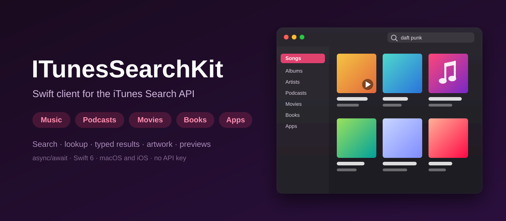
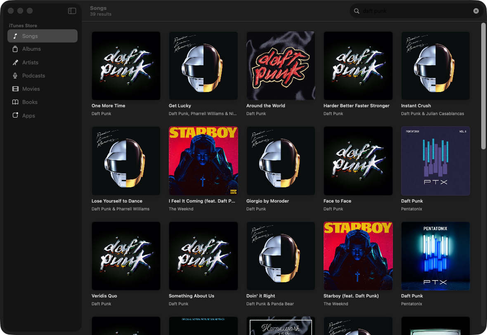
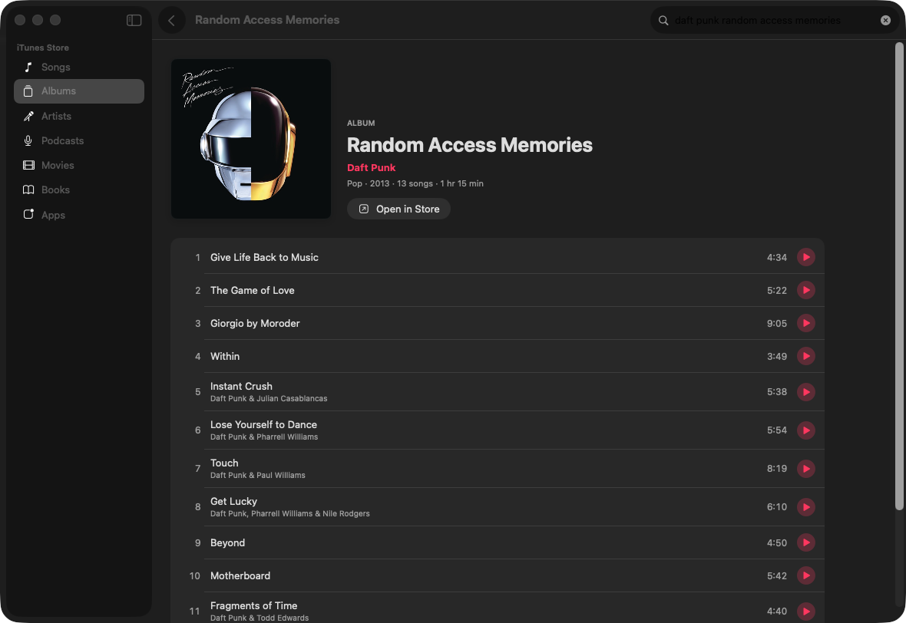
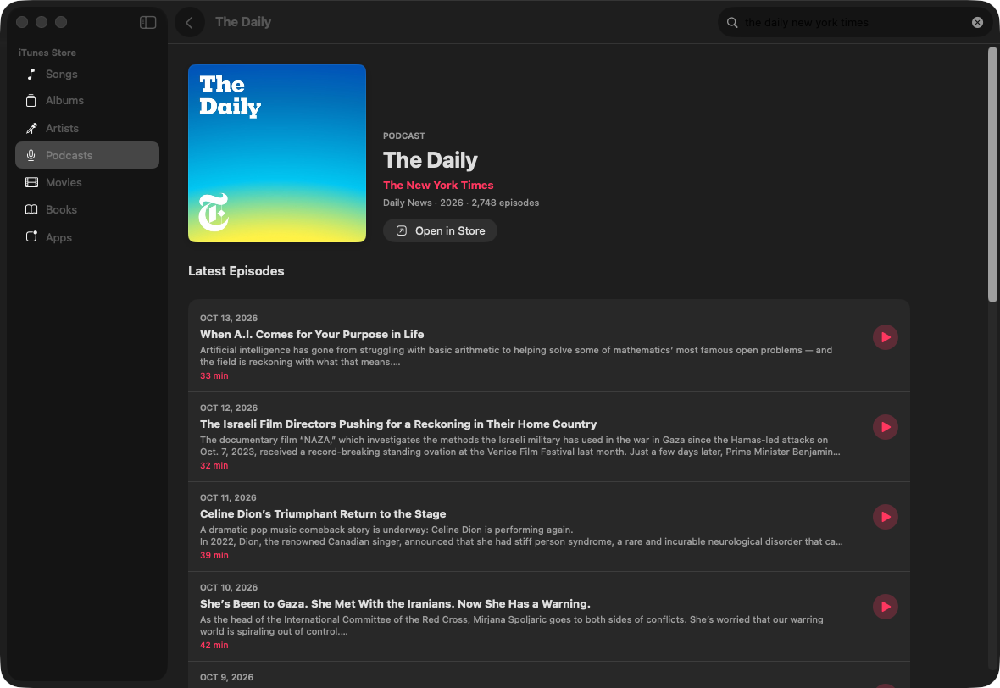
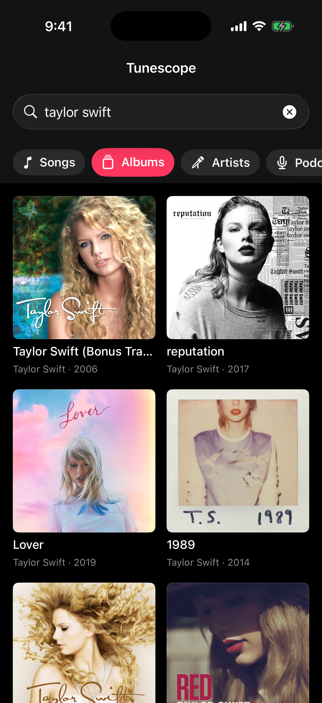
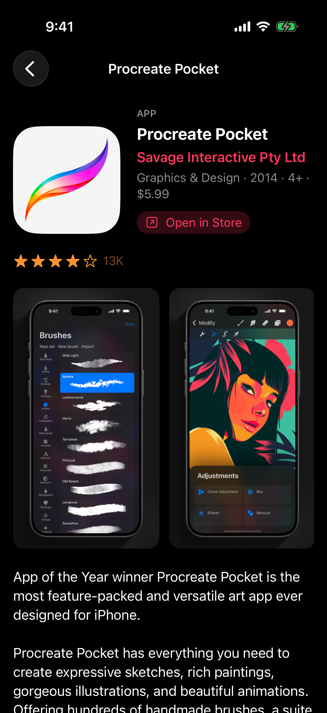

<p align="center">
  
</p>

<p align="center">
  <a href="https://github.com/halilozel1903/ITunesSearchKit/actions/workflows/ci.yml"></a>
  
  
  
  
  
  <a href="LICENSE"></a>
</p>

**ITunesSearchKit** is a Swift client for Apple's [iTunes Search API](https://performance-partners.apple.com/search-api), with SwiftUI views and an example **Mac and iPhone** app. Search and look up **music, podcasts, movies, books and apps**, and get every result back as a **typed model** in one `ITunesItem` enum: `Song`, `Album`, `Artist`, `Podcast`, `PodcastEpisode`, `Movie`, `Ebook`, `Audiobook`, `Software` and more. Ask for artwork at **any size** (the API only returns 100 × 100 thumbnails), play 30-second **previews**, and stay inside Apple's **rate limit** with built-in throttling and retries. async/await, Swift 6 strict concurrency, no API key, no dependencies.

```swift
import ITunesSearchKit

let itunes = ITunesClient()

let songs = try await itunes.songs(matching: "daft punk", limit: 10)
print(songs[0].name)                          // "Get Lucky (feat. Pharrell Williams & Nile Rodgers)"
print(songs[0].artwork?.url(size: 600) as Any) // …/600x600bb.jpg instead of …/100x100bb.jpg
print(songs[0].previewURL as Any)             // a 30-second AAC preview

let album = try await itunes.album(id: songs[0].albumID!)   // the album and its songs, in track order
for track in album.tracks {
    print(track.trackNumber ?? 0, track.name, ITunesFormat.duration(track.duration ?? 0))
}
```

## Screenshots

Captured live by CI from the example app, *Tunescope*, on the Mac and on an iPhone simulator. Every scene searches the **live iTunes Search API** at the time CI ran and shows the real results with their real artwork: songs for "daft punk", the album *Random Access Memories* with its songs, the latest episodes of *The Daily*, albums for "taylor swift" and the movie *Interstellar*. The app reports ready only after the results and every visible image have loaded; if the API or any image cannot be reached, the job fails instead of saving a capture.

| Mac: search | Mac: album |
| :---: | :---: |
|  |  |

| Mac: podcast | iPhone: search | iPhone: detail |
| :---: | :---: | :---: |
|  |  |  |

## Features

- **Search and lookup**: `/search` with media, entity, attribute, country, language, limit, offset and explicit filters, and `/lookup` by iTunes id, AMG id, UPC/EAN, ISBN or bundle identifier, each an `async throws` method.
- **One typed result enum**: `ITunesItem` has a case per kind (`.song`, `.musicVideo`, `.album`, `.artist`, `.podcast`, `.podcastEpisode`, `.movie`, `.ebook`, `.audiobook`, `.software`) and `.other` for anything new, so a mixed search is one `switch`. Shared properties (`name`, `creator`, `artwork`, `previewURL`, `storeURL`, `releaseDate`, `genre`, `duration`, `isExplicit`) work on every case.
- **Lenient decoding**: the API's loose types are handled for you (`fileSizeBytes` as a string, genres as strings or objects, `http` artwork URLs, dates with or without time), and a malformed result is skipped instead of failing the whole response.
- **Artwork at any size**: `artwork.url(size: 600)` turns Apple's `100x100bb.jpg` thumbnail into `600x600bb.jpg`; `url(width:height:format:)` fits posters into a box and switches to PNG or WebP.
- **Details in one call**: `album(id:)` returns the album with its songs in disc and track order, `podcast(id:)` the podcast with its latest episodes, `artist(id:)` an artist with albums.
- **Rate limits handled**: Apple allows roughly 20 requests a minute and answers 403 or 429 beyond that. Set `requestsPerMinute` and the client spaces requests out; a `RetryPolicy` retries rate limits (respecting `Retry-After`) and server errors with backoff, and anything left surfaces as `ITunesError.rateLimited(retryAfter:)`.
- **Validated before sending**: an empty term, a limit outside 1...200, a malformed ISBN or UPC, or a country that is not two letters throws `ITunesError.invalidRequest` without a request; the API's own message comes back as `ITunesError.api(message:statusCode:)`.
- **Formatting helpers**: `Price.formatted()` ("$1.29", "Free"), `ITunesFormat.duration` ("3:45"), `longDuration` ("2 hr 49 min"), `fileSize`, and `ITunesText.plainText(fromHTML:)` for book and app descriptions.
- **SwiftUI, optional**: the `ITunesSearchUI` library has `ArtworkImage` (resized artwork with a pluggable, cached loader), `ArtworkPlaceholder`, `PreviewPlayer` and `PreviewButton` for previews, `ExplicitBadge` and `RatingStars`.
- **Testable and tested**: point the client at any `URLSession` and host. The package's tests answer every request from a `URLProtocol` stub with hand-written JSON fixtures in the API's exact format, on macOS and iOS. The fixtures are for the unit tests only; the example app always uses the live API.
- **Swift 6 strict concurrency**: the client and every model are `Sendable`; the views and the player are `@MainActor`.

## API coverage

| Endpoint | Method |
| --- | --- |
| `GET /search` | `search(_:)` with a `SearchRequest` → `ITunesResponse`, or `search(_:media:entity:attribute:country:limit:)` → `[ITunesItem]` |
| `GET /search` (typed) | `songs(matching:)`, `albums(matching:)`, `artists(matching:)`, `podcasts(matching:)`, `movies(matching:)`, `ebooks(matching:)`, `apps(matching:platform:)` |
| `GET /lookup?id=` | `lookup(id:)` → `ITunesItem?`, `lookup(ids:)` → `[ITunesItem]` |
| `GET /lookup?id=&entity=song` | `album(id:)` → `AlbumDetail` (album and songs) |
| `GET /lookup?id=&entity=album` | `artist(id:albumLimit:newestFirst:)` → `ArtistDetail` (artist and albums) |
| `GET /lookup?id=&entity=podcastEpisode` | `podcast(id:episodeLimit:)` → `PodcastDetail` (podcast and episodes) |
| `GET /lookup?upc=` / `isbn=` / `bundleId=` | `album(upc:)`, `ebook(isbn:)`, `app(bundleID:)` |
| anything else | `lookup(_:)` with a `LookupRequest` (also `amgArtistId`, `amgAlbumId`, `sort=recent`), or `get(_:query:as:)` into your own `Decodable` |

## Installation

In Xcode choose **File › Add Package Dependencies…** and enter:

```
https://github.com/halilozel1903/ITunesSearchKit
```

Or add it to `Package.swift`:

```swift
dependencies: [
    .package(url: "https://github.com/halilozel1903/ITunesSearchKit", from: "1.0.0")
],
targets: [
    .target(name: "MyApp", dependencies: [
        .product(name: "ITunesSearchKit", package: "ITunesSearchKit"),
        .product(name: "ITunesSearchUI", package: "ITunesSearchKit"),   // optional SwiftUI views
    ])
]
```

## Usage

### Search

```swift
let itunes = ITunesClient.shared                     // the US store

var request = SearchRequest(term: "radiohead", entity: .album)
request.attribute = .artistTerm                      // match artist names only
request.country = "GB"                               // the UK store
request.limit = 50                                   // 1 to 200
request.allowsExplicit = false
let response = try await itunes.search(request)

response.albums                                      // [Album]
response.resultCount                                 // what the API reported

// Or typed shortcuts
let podcasts = try await itunes.podcasts(matching: "swift")
let movies = try await itunes.movies(matching: "nolan")
let macApps = try await itunes.apps(matching: "pixelmator", platform: .macOS)
```

`ITunesMedia`, `ITunesEntity` and `ITunesAttribute` cover every value Apple documents. The media follows from the entity when you give only an entity (`.song` sends `media=music`).

### Mixed results

```swift
let items = try await itunes.search("star wars", media: .all, limit: 25)

for item in items {
    switch item {
    case let .movie(movie):
        print("Movie:", movie.name, movie.contentRating ?? "", movie.director ?? "")
    case let .ebook(book):
        print("Book:", book.name, book.author, book.plainDescription ?? "")
    case let .software(app):
        print("App:", app.name, app.formattedPrice ?? "", app.averageRating ?? 0)
    case let .song(song):
        print("Song:", song.name, song.albumName ?? "")
    default:
        print(item.kind.title, item.name, item.creator ?? "")
    }
}
```

`item.id` is unique across kinds (`"song-617154366"`), so `ITunesItem` works directly in `ForEach` and `List`.

### Lookup

```swift
let album = try await itunes.album(id: 617154241)            // AlbumDetail
album.album.copyright
album.tracks.map(\.name)
album.totalDuration                                          // seconds

let daily = try await itunes.podcast(id: 1200361736, episodeLimit: 10)
daily.podcast.feedURL                                        // the RSS feed
daily.episodes.first?.episodeURL                             // the full episode audio

let artist = try await itunes.artist(id: 5468295, newestFirst: true)
let book = try await itunes.ebook(isbn: "978-0-593-13520-4") // hyphens are fine
let pages = try await itunes.app(bundleID: "com.apple.Pages")
let item = try await itunes.lookup(id: 909253)               // ITunesItem?
```

### Artwork

```swift
let artwork = song.artwork!          // https://…/100x100bb.jpg as returned
artwork.url(size: 600)               // …/600x600bb.jpg
artwork.url(size: 1024, format: .png)
movie.artwork?.url(width: 400, height: 600)          // a poster
Artwork.resized(someURL, width: 300, height: 300)    // nil when the URL has no size in it
```

The `bb` suffix fits the image into the box without cropping. `http` URLs in responses are upgraded to `https`.

### Previews

Songs, music videos, audiobooks, podcast episodes and movie trailers have a `previewURL`. Play audio previews with `AVPlayer`, or with the `PreviewPlayer` in `ITunesSearchUI`, which plays one at a time:

```swift
import ITunesSearchUI

@State private var player = PreviewPlayer()

PreviewButton(url: song.previewURL, player: player)   // play and pause
player.isPlaying(song.previewURL)                     // for a now-playing indicator
```

### Rate limits and errors

```swift
let itunes = ITunesClient(configuration: ITunesConfiguration(
    country: "TR",
    retryPolicy: RetryPolicy(maxRetries: 3, baseDelay: 2),   // 2 s, 4 s, 8 s, or what Retry-After says
    requestsPerMinute: 20                                    // space requests out
))

do {
    let songs = try await itunes.songs(matching: "tarkan")
} catch let error as ITunesError {
    switch error {
    case .rateLimited(let retryAfter): break    // still limited after the retries
    case .api(let message, let status): break   // the API's own message, such as an invalid media type
    case .invalidRequest(let reason): break     // checked before sending
    case .notFound(let what): break             // album(id:), artist(id:) or podcast(id:) found nothing
    case .http(let status, let url): break
    case .decoding(let type, let description): break
    case .transport(let urlError): break        // offline, timed out, cancelled
    case .invalidResponse: break
    }
}
```

`error.isTransient` tells whether trying again later may help.

### SwiftUI views

```swift
import ITunesSearchKit
import ITunesSearchUI

ArtworkImage(item: item, pixelSize: 600)           // resized artwork with a placeholder for its kind
    .aspectRatio(1, contentMode: .fit)
    .clipShape(.rect(cornerRadius: 8))

ArtworkImage(movie.artwork, pixelWidth: 400, pixelHeight: 600) {
    Color.gray.opacity(0.2)                        // your own placeholder
}

if song.isExplicit { ExplicitBadge() }
RatingStars(app.averageRating ?? 0, count: app.ratingCount)

ContentView()
    .artworkLoader(ArtworkLoader { url in try await MyCache.shared.data(for: url) })   // your own loading
```

### Testing

The client talks to whatever `URLSession` and host you give it, so tests can stub every response:

```swift
let configuration = URLSessionConfiguration.ephemeral
configuration.protocolClasses = [MyStubProtocol.self]

let client = ITunesClient(configuration: ITunesConfiguration(
    baseURL: URL(string: "https://itunes.test")!,
    session: URLSession(configuration: configuration),
    retryPolicy: .none
))
```

## Example app

The `Example` folder contains *Tunescope*, built with ITunesSearchKit and ITunesSearchUI:

- **Mac**: a sidebar of categories (songs, albums, artists, podcasts, movies, books and apps), search in the toolbar, an artwork grid of results, and pages for albums (track list with previews), podcasts (latest episodes), artists (albums), movies, books and apps.
- **iPhone**: the same search with category chips, a two-column grid and the same detail pages.

The project uses [XcodeGen](https://github.com/yonaskolb/XcodeGen) so no project file has to live in the repo:

```bash
brew install xcodegen
cd Example && xcodegen generate
open ITunesSearchDemo.xcodeproj
```

Run `TunescopeMac` on the Mac and `TunescopePhone` on an iPhone simulator. Launch with `-screenshot search|album|podcast` (Mac) or `-screenshot search|detail` (iPhone) to open the scene CI captures, with live data.

## Requirements

- Xcode 26 or later (Swift 6.2 toolchain)
- macOS 14+ or iOS 17+

## Notes

The iTunes Search API is free and needs no key. Apple asks that it be used to promote store content (link to `storeURL`), limits it to roughly 20 calls per minute, and may change it at any time; see Apple's [Search API documentation](https://performance-partners.apple.com/search-api). ITunesSearchKit is an unofficial client and is not affiliated with Apple. iTunes, Apple Music, Apple Podcasts and the App Store are trademarks of Apple Inc.

## Contributing

Issues and pull requests are welcome. Please run the tests before opening a PR:

```bash
swift test
bash scripts/test.sh iOS
```

## License

ITunesSearchKit is available under the MIT license. See [LICENSE](LICENSE).
